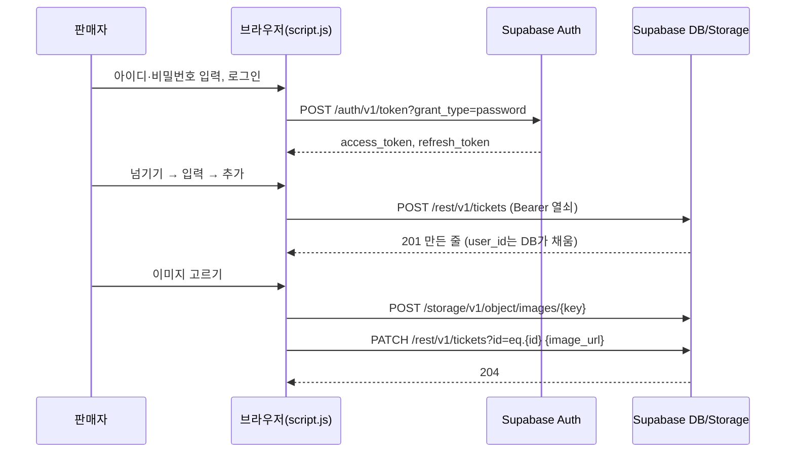

# 넘겨 API 명세서

> 기준: `script.js`(브라우저)와 `api/cleanup.js`(Vercel 서버 함수)가 실제로 보내는 요청. 별도 백엔드 서버는 없고 **브라우저가 Supabase를 직접 부른다.** 서버 코드는 하루 한 번 도는 자동 삭제 함수 하나뿐이다.
> 관련 문서: [PRD](PRD.md) · [화면 설계서](화면설계서.md) · [ERD](ERD.md)

## 0. 공통

| 항목 | 값 |
| --- | --- |
| 기본 주소 | `https://sijsxqhlaxtlmxdkmhuk.supabase.co` |
| 공개 키 | `sb_publishable_…` (화면 코드에 들어 있는 공개 값) |
| 데이터 형식 | JSON (`Content-Type: application/json`), 이미지 올리기만 파일 그대로 |

모든 요청의 머리말

| 머리말 | 값 | 언제 |
| --- | --- | --- |
| `apikey` | 공개 키 | 항상 |
| `Authorization` | `Bearer {access_token}` | 로그인했을 때 (로그아웃 상태면 붙이지 않음 = `anon`) |
| `Content-Type` | `application/json` | 본문이 JSON일 때 |
| `Prefer` | `return=representation` | 글 등록(응답에 만든 줄을 돌려받음) |

로그인 열쇠(`access_token`)는 끝나기 60초 전에 자동으로 새로 받는다 (`refresh_token`). 새로 받지 못하면 로그아웃 상태가 된다.

## 1. 인증 (Supabase Auth)

### 1-1. 아이디 → 번호 바꾸기 (브라우저 규칙)

화면의 **아이디(숫자 11자리)** 는 Supabase에 전화번호처럼 보낸다.

| 아이디 | 보내는 `phone` | 규칙 |
| --- | --- | --- |
| `01012345678` | `+821012345678` | 0으로 시작하면 0을 빼고 `+82` 붙임 |
| `12345678901` | `+8212345678901` | 0으로 시작하지 않으면 그대로 `+82` 붙임 |
| `01012345` 등 | (보내지 않음) | 숫자 11자리가 아니면 화면에서 거절 |

Supabase가 돌려주는 `user.phone`(`821012345678`)은 화면에서 다시 `01012345678`로 되돌려 보여 준다.

> 이 방식은 Supabase의 **Phone 로그인 사용 + 문자 인증(Confirm phone) 끔**이 필요하다. 꺼져 있으면 `phone_provider_disabled`가 온다 (PRD 미결 Q1).

### 1-2. 가입

`POST /auth/v1/signup`

```json
{ "phone": "+821012345678", "password": "password1" }
```

| 응답 | 의미 | 화면 처리 |
| --- | --- | --- |
| 200 + `access_token`, `refresh_token`, `expires_in`, `user` | 가입과 동시에 로그인 | 로그인 상태로, 목록 다시 읽기 |
| 200 + `access_token` 없음 | 문자 인증 대기 | "가입했어요. 문자 인증이 켜져 있으면…" 안내 |
| 4xx/5xx | 실패 | 6장 매핑대로 안내 |

### 1-3. 로그인

`POST /auth/v1/token?grant_type=password`

```json
{ "phone": "+821012345678", "password": "password1" }
```

성공 200

```json
{ "access_token": "…", "refresh_token": "…", "expires_in": 3600,
  "user": { "id": "uuid", "phone": "821012345678" } }
```

브라우저는 `localStorage['ticket-session']`에 `access_token`, `refresh_token`, `expires_at`(ms), `user_id`, `name`(내 아이디)을 저장한다.

### 1-4. 열쇠 새로 받기

`POST /auth/v1/token?grant_type=refresh_token` — 본문 `{ "refresh_token": "…" }` → 200 (1-3과 같은 모양)

### 1-5. 로그아웃

`POST /auth/v1/logout` — `Authorization: Bearer {access_token}`, 본문 `{}` → 204. 서버에 알리지 못해도 브라우저의 로그인 정보는 지운다.

## 2. 양도권 (PostgREST: `/rest/v1/tickets`)

권한은 [ERD](ERD.md) 3장의 RLS가 정한다. 허용되지 않은 수정·삭제는 **오류 없이 0건 처리(204)** 될 수 있으므로, 화면은 남의 글에 버튼을 만들지 않는다.

| ID | 동작 | 요청 | 권한 | 성공 |
| --- | --- | --- | --- | --- |
| T-1 | 목록 읽기 | `GET /rest/v1/tickets?select=*&order=created_at.asc` | 누구나 | 200 줄 배열 |
| T-2 | 글 등록 | `POST /rest/v1/tickets` | 로그인 | 201 `[ 만든 줄 ]` |
| T-3 | 판매 상태 변경 | `PATCH /rest/v1/tickets?id=eq.{id}` | 글쓴이 | 204 |
| T-4 | 이미지 주소 저장·지움 | `PATCH /rest/v1/tickets?id=eq.{id}` | 글쓴이 | 204 |
| T-5 | 글 삭제 | `DELETE /rest/v1/tickets?id=eq.{id}` | 글쓴이 | 204 |

### T-1 목록 읽기

화면은 전부 읽은 뒤 브라우저에서 정렬·숨김을 한다 (상영 시각 기준, 한국 시간). 응답 줄 모양

```json
{ "id": 12, "movie": "킬링타임", "theater": "메가박스 제주아라", "price": 3000,
  "recliner": true, "link_url": null, "phone": "010-1234-5678", "image_url": null,
  "show_date": "2026-11-05", "show_time": "19:50:00", "status": "판매 중",
  "user_id": "uuid", "created_at": "2026-11-05T03:10:00+00:00" }
```

### T-2 글 등록

머리말에 `Prefer: return=representation`. 본문

```json
{ "movie": "킬링타임", "theater": "메가박스 제주아라", "price": 3000, "recliner": true,
  "link_url": null, "phone": "010-1234-5678",
  "show_date": "2026-11-05", "show_time": "19:50" }
```

| 필드 | 형식 | 필수 | 검사 (화면 → DB) |
| --- | --- | --- | --- |
| `movie` | 글 | O | 비면 거절 (화면) / `not null` |
| `theater` | 글 | | 고르는 7곳 중 하나 |
| `price` | 정수 | O | 0~16,000 (화면) / `price >= 0`, `price_max` (DB) |
| `recliner` | true/false | | 기본 false |
| `link_url` | 글 또는 null | 둘 중 하나 | `http(s)://` + `daangn` 포함 (화면). 전화번호를 골랐으면 `null` |
| `phone` | 글 또는 null | 둘 중 하나 | 숫자와 `-`, 숫자 9~11자리 (화면). 링크를 골랐으면 `null` |
| `show_date` | `YYYY-MM-DD` | O (화면) | 한국 오늘 이후, 이미 지난 시각이면 거절 |
| `show_time` | `HH:MM` 또는 null | | 시 칸이 비면 `null`. 0~23시 |
| `user_id` | (보내지 않음) | | DB 기본값 `auth.uid()`가 채움 |
| `status` | (보내지 않음) | | 기본 `'판매 중'` |

응답 201: 만들어진 줄 배열 `[ { "id": 13, … } ]` (화면은 `id`를 받아 목록에 추가).

### T-3 판매 상태 변경

`PATCH /rest/v1/tickets?id=eq.12` — 본문 `{ "status": "예약 중" }`
허용 값: `판매 중` · `예약 중` · `판매 완료` (그 밖의 값은 DB가 거절). 화면은 먼저 바꿔 보여 주고, 실패하면 원래대로 되돌린다.

### T-4 이미지 주소 저장·지움

본문 `{ "image_url": "https://…/storage/v1/object/public/images/12-1730000000000.png" }` 또는 `{ "image_url": null }`

### T-5 글 삭제

`DELETE /rest/v1/tickets?id=eq.12` → 204. 이미지가 있던 글이면 이어서 3장의 S-3(저장소 파일 삭제)를 부른다.

## 3. 이미지 저장소 (Supabase Storage, 버킷 `images`)

| ID | 동작 | 요청 | 권한 | 성공 |
| --- | --- | --- | --- | --- |
| S-1 | 이미지 올리기 | `POST /storage/v1/object/images/{key}` | 로그인 | 200 |
| S-2 | 이미지 보기 | `GET /storage/v1/object/public/images/{key}` | 누구나 (공개 버킷) | 200 이미지 |
| S-3 | 이미지 지우기 | `DELETE /storage/v1/object/images` | 올린 사람 | 200 `[지워진 파일…]` |

- **S-1**: 머리말 `Content-Type: {이미지 형식}`, 본문은 파일 그대로. `{key}` = `{글번호}-{올린 시각(ms)}{확장자}` (한글 불가). 화면이 먼저 검사: 이미지 형식만, 5MB 이하. 버킷도 같은 제한을 건다.
- **S-3**: 본문 `{ "prefixes": ["12-1730000000000.png"] }`. 응답 배열이 **비어 있으면 지워지지 않은 것**(권한 없음)이고, 화면은 "표에서는 지웠지만 저장소의 이미지 파일은 지우지 못했어요…"라고 알린다.

이미지 흐름

| 동작 | 호출 순서 |
| --- | --- |
| 이미지 추가·바꾸기 | S-1 올림 → T-4 새 주소 저장 → (바꾸는 경우) S-3 옛 파일 삭제 |
| 이미지 지우기(×) | T-4 `null` 저장 → S-3 파일 삭제 |
| 글 삭제 | T-5 글 삭제 → (이미지가 있었으면) S-3 파일 삭제 |

## 4. 서버 함수: 하루 지난 글 자동 삭제

`GET /api/cleanup` (Vercel 서버 함수 `api/cleanup.js`)

| 항목 | 값 |
| --- | --- |
| 호출 | Vercel Cron이 하루 한 번 (`vercel.json`: `10 15 * * *` = UTC 15:10 = **한국 0:10**, 무료 요금제는 ±1시간 흔들림) |
| 인증 | 머리말 `Authorization: Bearer {CRON_SECRET}` (Vercel이 환경 변수 `CRON_SECRET`을 자동으로 붙임) |
| 환경 변수 | `SUPABASE_SECRET_KEY` (또는 옛 이름 `SUPABASE_SERVICE_ROLE_KEY`), `CRON_SECRET`, (선택) `SUPABASE_URL` |

하는 일

1. 한국 오늘 날짜(`today`)와 24시간 전 시각을 구한다.
2. `GET /rest/v1/tickets?select=id,image_url&or=(show_date.lt.{today},and(show_date.is.null,created_at.lt.{24시간 전}))` 로 지울 글을 찾는다 (비밀 키라 RLS를 건너뜀).
3. `DELETE /rest/v1/tickets?id=in.(…)` 를 100개씩 나눠 지운다.
4. 지운 글의 `image_url`에서 파일 이름을 꺼내 `DELETE /storage/v1/object/images` 로 100개씩 지운다.

| 응답 | 본문 | 의미 |
| --- | --- | --- |
| 200 | `{ "today": "2026-11-05", "deleted": 3, "images": 2, "imagesExpected": 2 }` | 삭제 결과 (`images`가 `imagesExpected`보다 작으면 일부 파일 못 지움) |
| 401 | `{ "error": "암호가 맞지 않아요." }` | 암호 틀림·없음 (아무것도 지우지 않음) |
| 503 | `{ "error": "CRON_SECRET과 SUPABASE_SECRET_KEY를 …" }` | 환경 변수 없음 (열려 있는 주소가 되지 않도록 거절) |
| 500 | `{ "error": "…" }` | Supabase 요청 실패 |

> 비밀 키는 이 함수 안에서만 쓰고, 브라우저 코드와 저장소 파일에는 절대 두지 않는다. 새 비밀 키(`sb_secret_…`)는 `apikey` 머리말로만, 옛 JWT 키는 `Authorization`에도 함께 보낸다.

## 5. 브라우저 저장값 (`localStorage`)

| 키 | 내용 |
| --- | --- |
| `ticket-session` | 로그인 정보 `{access_token, refresh_token, expires_at, user_id, name}` |
| `todo-dark` | 어두운 화면 사용 여부 (`'true'`) |

## 6. 오류 → 화면 안내 매핑

### 6-1. 표·저장소 요청 (PostgREST)

오류 본문 `{ "code": "…", "message": "…", "details": …, "hint": … }`. 화면은 `표에 저장하지 못했어요. {안내}` 뒤에 `(Supabase 답: {상태} {code} {message})` 를 붙인다.

| 상태 / code | 안내 |
| --- | --- |
| (응답 없음) | 인터넷에 연결되지 않았거나 Supabase에 닿지 않아요. |
| 404 `PGRST205`, `42P01` | `tickets` 표가 없어요. SQL을 실행해 주세요. |
| 400 `PGRST204`, `42703` | 표에 필요한 칸이 없어요. SQL(칸 추가)을 실행해 주세요. |
| 403 `42501` | 권한이 없어요. 로그인·RLS를 확인해 주세요. |
| 400 `23514` | 표의 규칙에 맞지 않는 값이에요 (예: 가격 16,000원 초과). |
| 400 `23502` | 꼭 필요한 칸이 비어 있어요. |
| 401 | `로그인이 풀렸어요. 다시 로그인해 주세요.` (로그인 정보를 지우고 로그아웃 상태로) |
| 그 밖 | 이유를 알 수 없어요. |

### 6-2. 로그인·가입 (Auth)

오류 본문 `{ "code": 400, "error_code": "…", "msg": "…" }`. 화면은 `로그인하지 못했어요.` / `가입하지 못했어요.` + 안내 + `(Supabase 답: …)`.

| `error_code` / 상태 | 안내 |
| --- | --- |
| (응답 없음) | 인터넷에 연결되지 않았거나 Supabase에 닿지 않아요. |
| `phone_provider_disabled`, `signup_disabled` | Supabase에서 전화번호 가입이 꺼져 있어요. Authentication → Sign In / Providers → Phone을 켜 주세요. |
| `sms_send_failed`, `over_sms_send_rate_limit`, 429 | 문자를 보내지 못했어요. Phone 설정에서 Confirm phone을 꺼 주세요. |
| `user_already_exists`, `phone_exists` | 이미 가입한 아이디예요. 로그인해 주세요. |
| `weak_password` | 비밀번호가 너무 약해요. |
| `validation_failed` | 아이디나 비밀번호 모양이 올바르지 않아요. |
| `invalid_credentials` | 아이디나 비밀번호가 틀렸어요. 가입하지 않았다면 먼저 가입해 주세요. |
| `phone_not_confirmed` | 문자 인증이 안 된 아이디예요. Confirm phone을 꺼 주세요. |
| 그 밖 | 이유를 알 수 없어요. |

## 7. 화면 동작 ↔ API 대응

| 화면 동작 | 호출 |
| --- | --- |
| 페이지 열기 | (필요하면 1-4 열쇠 새로 받기) → T-1 |
| 가입 / 로그인 | 1-2 / 1-3 → T-1 |
| 로그아웃 | 1-5 |
| `추가` | T-2 |
| 판매 상태 버튼 | T-3 |
| `이미지` / `바꾸기` | S-1 → T-4 → (S-3) |
| 이미지 `×` | T-4 → S-3 |
| `삭제` | T-5 → (S-3) |
| 줄 누르기 / `전화` | (API 호출 없음) 브라우저가 링크·전화 앱을 연다 |
| 1분마다 | (API 호출 없음) 이미 읽은 목록을 다시 그림 |
| 매일 새벽 | `/api/cleanup` |



## 8. 개선 후보 (API)

- 목록을 페이지로 나눠 읽기 (`limit`/`offset`) 와 서버에서 상영 시각으로 거르기·정렬하기
- 글 수정 `PATCH` (영화·가격 등) 추가
- 예약·평가·알림·신고용 요청 (ERD 5장 확장안)
- 이미지 올리기와 `image_url` 저장을 하나의 서버 함수로 묶어, 중간 실패 시 고아 파일이 남지 않게 하기
