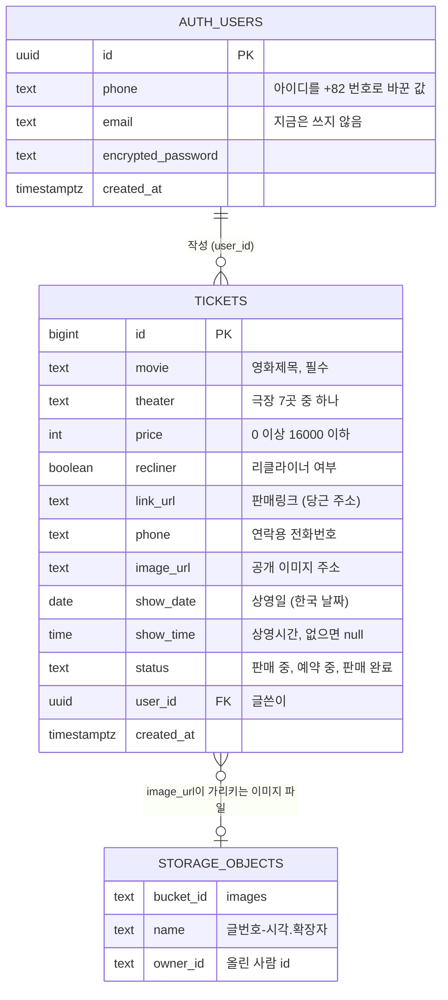
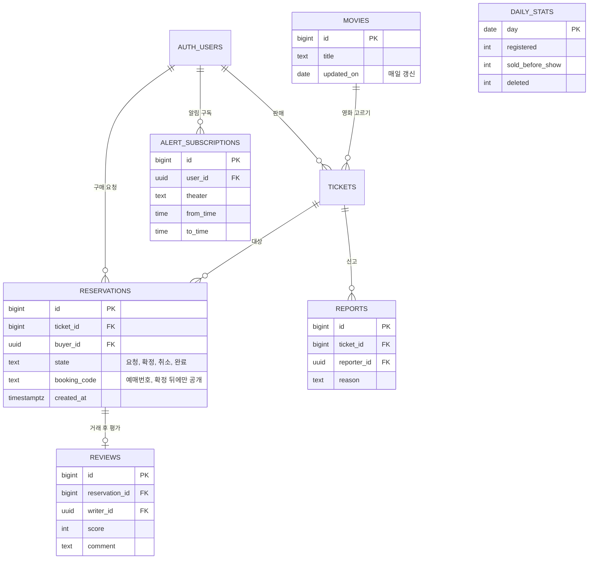

# 넘겨 ERD (데이터 설계서)

> 기준: 현재 코드(`script.js`, `api/cleanup.js`)가 읽고 쓰는 Supabase 구조. 앞으로의 확장안은 5장에 따로 적었고 **아직 만들어지지 않았다**.
> 관련 문서: [PRD](PRD.md) · [화면 설계서](화면설계서.md) · [API 명세서](API명세서.md)

## 1. 현재 ERD



- `AUTH_USERS`와 `STORAGE_OBJECTS`는 Supabase가 관리하는 표다. 우리가 만든 표는 `TICKETS` 하나다.
- `TICKETS`와 `STORAGE_OBJECTS`는 외래 키가 아니라 **주소 글자(`image_url`)로만 이어진다.** 그래서 글을 지울 때 이미지 파일도 따로 지워야 한다 (화면 코드와 자동 삭제 작업이 한다).

## 2. 표 정의: `tickets`

| 칸 | 형식 | 필수 | 기본값 | 규칙·설명 |
| --- | --- | --- | --- | --- |
| `id` | bigint | O (자동) | `generated always as identity` | 기본 키 |
| `movie` | text | O | | 영화제목 |
| `theater` | text | | | 극장 이름: CGV 제주 · CGV 제주노형 · 롯데시네마 제주연동 · 롯데시네마 서귀포 · 메가박스 제주아라 · 메가박스 제주삼화 · 메가박스 제주서귀포 (화면이 고르게 함, DB 제약 없음) |
| `price` | integer | | | `check (price >= 0)`, `price_max` 제약 `check (price <= 16000)` |
| `recliner` | boolean | O | `false` | 리클라이너 여부 |
| `link_url` | text | | | 판매링크. 화면이 `http(s)://` + `daangn` 포함만 받음. `link_url`과 `phone` 중 **하나만** 채워짐 (화면 규칙) |
| `phone` | text | | | 연락용 전화번호 (숫자와 `-`, 9~11자리). 로그인용 번호와는 별개 |
| `image_url` | text | | | 공개 이미지 주소: `…/storage/v1/object/public/images/{글번호}-{시각}{확장자}` |
| `show_date` | date | | | 상영일 (한국 날짜). 화면은 필수로 받지만 옛 글은 비어 있을 수 있음 |
| `show_time` | time | | | 상영시간 `HH:MM:SS`. 비어 있으면 그날 23:59로 계산. **`24:10` 같은 값은 못 넣는다** (자정 이후는 다음 날 0시로) |
| `status` | text | O | `'판매 중'` | `check (status in ('판매 중','예약 중','판매 완료'))` |
| `user_id` | uuid | | `auth.uid()` | 글쓴이. `auth.users(id)` 참조. 옛 글은 null (아무도 수정·삭제 불가) |
| `created_at` | timestamptz | O | `now()` | 올린 시각. 목록의 같은 순위 정렬(추가 순)에 쓰임 |

### 파생 값 (칸이 아니라 계산)

| 이름 | 계산 |
| --- | --- |
| 상영 시각 | `show_date` + (`show_time` 또는 `23:59`), 한국 시간(+09:00). `show_date`가 없으면 없음 |
| 목록에 보이는 글 | 상영 시각 ≥ 지금(분 단위) 이거나 상영 시각이 없는 글 |
| 정렬 키 | ① `status = '판매 완료'`는 뒤로 ② 상영 시각 오름차순 ③ 상영 시각 없는 글은 뒤 ④ `created_at` 순 |
| 판매 중 개수 | 보이는 글 중 `status = '판매 중'` 개수 |
| 자동 삭제 대상 | `show_date < 오늘(한국)` 이거나, `show_date`가 없고 `created_at < 지금 − 24시간` |

## 3. 권한 규칙 (RLS)

`tickets`에는 RLS를 켜 두고 아래 규칙만 둔다.

| 정책 | 명령 | 대상 | 조건 |
| --- | --- | --- | --- |
| `tickets read` | SELECT | anon, authenticated | 누구나 (`true`) |
| `tickets insert` | INSERT | authenticated | `user_id = auth.uid()` (기본값 `auth.uid()`가 채움) |
| `tickets update own` | UPDATE | authenticated | `user_id = auth.uid()` (사용 전·후 모두) |
| `tickets delete own` | DELETE | authenticated | `user_id = auth.uid()` |

- 서버의 **비밀 키**로 부르는 자동 삭제 작업(`/api/cleanup`)은 RLS를 건너뛴다.
- 읽기가 모두에게 열려 있어서 **전화번호도 모두에게 보인다** ([PRD](PRD.md) 미결 Q2).

## 4. 저장소: `images` 버킷

| 항목 | 값 |
| --- | --- |
| 공개 여부 | 공개 (주소만 알면 누구나 볼 수 있음) |
| 크기 제한 | 5MB (5242880바이트) |
| 허용 형식 | `image/png`, `image/jpeg`, `image/gif`, `image/webp` |
| 파일 이름 | `{글번호}-{올린 시각(ms)}{확장자}` (한글 이름은 못 쓰므로 번호와 확장자만) |
| 올리기 | `authenticated`만 (`images upload auth`) |
| 지우기 | 올린 사람만 (`images delete own`: `owner_id = auth.uid()::text`) |
| 글당 이미지 | 1장 (바꾸면 옛 파일 삭제) |

## 5. 확장안 (미구현, 제안)

사업계획서 MVP ②③④와 지표에 필요한 표다. 지금은 없다.



| 표 | 목적 | 계획서 연결 |
| --- | --- | --- |
| `reservations` | 예약 요청 → 판매자 확인 → 예매번호 공개 | MVP ③ 결제 후 예매번호 공개 |
| `reviews`, `reports` | 거래 후 평가, 신고 | MVP ④ |
| `alert_subscriptions` | 극장·시간대별 임박 알림 | MVP ② |
| `movies` | 상영작 제목 목록 (매일 갱신) | 영화제목 고르기 |
| `daily_stats` | **자동 삭제 전에 하루 집계를 남김** (성사율·재이용률 계산) | 지표 (PRD Q4) |

## 6. 개선 제안 (현재 표)

| 제안 | 이유 |
| --- | --- |
| `check (num_nonnulls(link_url, phone) = 1)` | "연락 방법은 하나만" 규칙을 DB에서도 지킴 (옛 글 정리 후 적용) |
| `theater`에 허용 값 검사 또는 `theaters` 표 | 오타·옛 이름 방지 |
| 인덱스: `(show_date, show_time)`, `(user_id)`, `(created_at)` | 목록 정렬·자동 삭제·내 글 조회 속도 |
| `show_date`를 필수로 (`not null`) | 옛 글 정리 뒤 적용 |
| `link_url` check (`like 'https://%'`) | 서버에서도 `javascript:` 같은 주소 차단 |

## 7. 만드는 SQL (전체)

```sql
create table if not exists tickets (
  id bigint generated always as identity primary key,
  movie text not null,
  theater text,
  price integer check (price >= 0),
  recliner boolean not null default false,
  link_url text,
  phone text,
  image_url text,
  show_date date,
  show_time time,
  status text not null default '판매 중' check (status in ('판매 중', '예약 중', '판매 완료')),
  user_id uuid default auth.uid() references auth.users(id),
  created_at timestamptz not null default now()
);
alter table tickets drop constraint if exists price_max;
alter table tickets add constraint price_max check (price <= 16000);

alter table tickets enable row level security;
create policy "tickets read" on tickets for select to anon, authenticated using (true);
create policy "tickets insert" on tickets for insert to authenticated with check (user_id = auth.uid());
create policy "tickets update own" on tickets for update to authenticated using (user_id = auth.uid()) with check (user_id = auth.uid());
create policy "tickets delete own" on tickets for delete to authenticated using (user_id = auth.uid());

insert into storage.buckets (id, name, public, file_size_limit, allowed_mime_types)
  values ('images', 'images', true, 5242880, array['image/png','image/jpeg','image/gif','image/webp'])
  on conflict (id) do nothing;
create policy "images upload auth" on storage.objects for insert to authenticated with check (bucket_id = 'images');
create policy "images delete own" on storage.objects for delete to authenticated using (bucket_id = 'images' and owner_id = auth.uid()::text);

notify pgrst, 'reload schema';
```

> 이미 있는 정책은 `drop policy if exists "이름" on …;`으로 먼저 지운 뒤 만든다.
