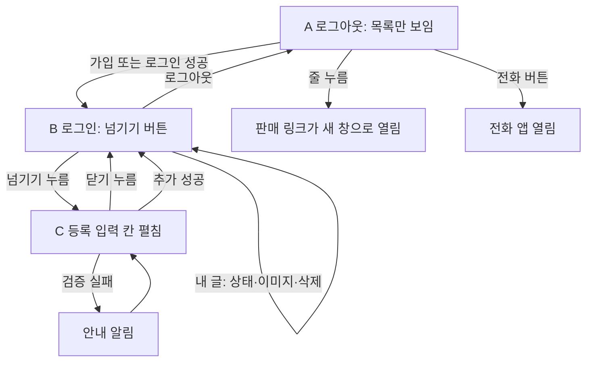

# 넘겨 화면 설계서

> 기준: `index.html`, `style.css`, `script.js`와 `명세.md`(현재 구현). 화면은 **한 장(S-01)** 이고, 로그인 여부와 '넘기기' 버튼에 따라 상태가 바뀐다.
> 관련 문서: [PRD](PRD.md) · [ERD](ERD.md) · [API 명세서](API명세서.md)

## 1. 화면 목록

| ID | 화면 | 설명 |
| --- | --- | --- |
| S-01 | 메인 (목록·로그인·등록) | 유일한 화면. 아래 상태 A~D로 나뉜다 |
| - | 브라우저 기본 창 | 알림(`alert`), 확인(`confirm`), 사진 고르기, 날짜 고르기, 전화 앱 (직접 만든 화면이 아님) |

| 상태 | 이름 | 보이는 것 |
| --- | --- | --- |
| A | 로그아웃 | 화면 색 버튼, 로그인 칸, 목록 |
| B | 로그인 (등록 접힘) | 화면 색 버튼, 내 아이디·로그아웃, **넘기기** 버튼, 목록 |
| C | 로그인 (등록 펼침) | B + 등록 입력 칸 전체, 버튼 글자는 **닫기** |
| D | 목록 줄의 모양 | 내 글 / 남의 글 / 전화·이미지 유무 / 판매 완료 |

## 2. 화면 흐름



## 3. S-01 와이어프레임

### 상태 A: 로그아웃

```
┌──────────────────────────────┐
│ [어두운 화면]                │
│ ┌──────────────────────────┐ │
│ │ 아이디 (숫자 11자리)     │ │
│ └──────────────────────────┘ │
│ ┌──────────────────────────┐ │
│ │ 비밀번호 (8자 이상)      │ │
│ └──────────────────────────┘ │
│ [   로그인   ] [    가입    ] │
│                              │
│ 킬링타임 메가박스 제주아라   │
│ 오늘 19:50 3000원 리클라이너 │
│ 판매 중  010-1234-5678 [전화]│
│ ──────────────────────────── │
│ 듄 CGV 제주 내일 10:00 5000원│
│ 판매 중                      │
│ ──────────────────────────── │
│ 판매 중: 2개                 │
└──────────────────────────────┘
```

### 상태 B: 로그인 (등록 접힘)

```
┌──────────────────────────────┐
│ [어두운 화면]                │
│ 01012345678        [로그아웃]│
│ [          넘기기          ] │
│ 킬링타임 메가박스 제주아라   │
│ 오늘 19:50 3000원 리클라이너 │  ← 내 글: 삭제 버튼, 상태 버튼
│ [판매 중] 010-… [전화] [이미지]  [삭제]
│ ...                          │
└──────────────────────────────┘
```

### 상태 C: 등록 입력 칸 펼침 (위에서 아래 순서)

```
[          닫기          ]
┌ 영화제목 ───────────────┐
┌ 극장 ▼ (CGV 제주 …)    ┐
[−500] ┌ 가격 (원) ┐ [+500]
☐ 리클라이너
(●) 판매링크   ( ) 전화번호
┌ 판매링크 (당근 링크) ──┐   ← 전화번호를 고르면 전화번호 칸으로 바뀜
┌ 상영일 [yyyy-mm-dd] ───┐   ← 처음 값: 오늘(한국 시간)
┌ 시 ▼ ┐ ┌ 분 ▼ ┐           ← 처음 값: 지금 한국 시간
[            추가            ]
```

### 상태 D: 목록 줄 해부도

```
┌ 첫 줄 (row-main) ───────────────────────────────┐
│ 영화 극장 상영일 상영시간 가격 리클라이너 …  [삭제]│  ← 삭제는 내 글에만
├ 둘째 줄 (row-info) ─────────────────────────────┤
│ 판매 상태(글자 또는 버튼) · 전화번호 · [전화] · [이미지] │
├ 셋째 줄 (thumb-row, 이미지가 있을 때) ──────────┤
│ [미리보기 이미지]  [바꾸기] [×]                 │  ← 바꾸기·×는 내 글에만
└──────────────────────────────────────────────────┘
줄 전체(버튼 아닌 곳)를 누르면: 판매 링크가 있을 때 새 창으로 이동
```

| 줄 종류 | 첫 줄 | 둘째 줄 | 셋째 줄 |
| --- | --- | --- | --- |
| 남의 글 | 글자만 | 상태(글자), 전화번호가 있으면 번호와 `전화` | 이미지가 있으면 미리보기만 |
| 내 글 | 글자 + `삭제` | 상태(버튼), 전화번호, `이미지`(이미지 없을 때만) | 미리보기 + `바꾸기` + `×` |
| 판매 완료 | 글자가 흐려지고 맨 아래로 | 상태 `판매 완료` | 위와 같음 |
| 판매 링크 있음 | 줄에 손가락 커서, 누르면 새 창 | | |

## 4. 구성 요소 목록

| 요소 | id / class | 종류 | 상태·규칙 |
| --- | --- | --- | --- |
| 화면 색 버튼 | `#theme` | 버튼 | 글자 `어두운 화면` ↔ `밝은 화면`, 선택값 저장 |
| 아이디 | `#login-id` | 글 칸 | 숫자만 11자리, 숫자 키패드(`inputmode=numeric`) |
| 비밀번호 | `#password` | 비밀번호 칸 | 8자 이상(가입), Enter로 로그인 |
| 로그인 / 가입 | `#login` / `#signup` | 버튼 | 로그아웃 상태에서만 보임 |
| 내 아이디 / 로그아웃 | `#who` / `#logout` | 글자 / 버튼 | 로그인 상태에서만 보임 |
| 넘기기 / 닫기 | `#open-form` | 버튼 | 로그인했을 때만, 등록 칸을 펼침·접음 |
| 영화제목 | `#movie` | 글 칸 | 필수 |
| 극장 | `#theater` | 고르기 | 7곳 |
| 가격 | `#price`, `#price-minus`, `#price-plus` | 숫자 칸 + 버튼 | 0~16,000, 500 단위 버튼, 빈 칸은 0으로 계산 |
| 리클라이너 | `#recliner` | 체크 | 선택 |
| 연락 방법 | `input[name=contact]` | 동그라미 선택 | `판매링크`(기본) / `전화번호` |
| 판매링크 / 전화번호 | `#link` / `#phone` | 글 칸 | 고른 쪽만 보임·필수 |
| 상영일 | `#show-date` | 날짜 | 필수, 오늘 이전 선택 불가, 기본 오늘 |
| 상영시간 | `#show-hour`, `#show-minute` | 고르기 2개 | 시 0~23(맨 위 `상영시간`=없음), 분 00~59, 기본 지금 |
| 추가 | `#add` | 버튼 | 검증 통과 시 저장하고 등록 칸을 접음 |
| 목록 | `#list` | 목록 | 상영 임박순, 판매 완료 아래 |
| 개수 | `#count` | 글자 | `판매 중: N개` (판매 중인 것만) |

## 5. 동작 규칙 (이벤트별)

| 사용자 동작 | 결과 |
| --- | --- |
| `가입` | 아이디·비밀번호 검증 → 가입 → 로그인 상태(B). 문자 인증이 켜져 있으면 안내만 뜸 |
| `로그인` | 성공 시 상태 B, 로그인 정보를 브라우저에 저장 (새로고침해도 유지) |
| `넘기기` / `닫기` | 등록 칸 펼침·접음. 펼칠 때 상영일·시간 기본값을 지금으로 맞춤 |
| `+500` / `−500` | 가격 ±500, 0과 16,000에서 멈춤 |
| 연락 방법 선택 | 링크 칸 ↔ 전화번호 칸 전환 |
| `추가` | 검증 통과 → 저장 → 목록에 반영, 입력 칸 비움, 등록 칸 접힘 |
| 상영일·시간 칸을 직접 고름 | 이후엔 자동으로 바뀌지 않음 (추가하면 다시 지금으로) |
| 내 글 상태 버튼 | 판매 중 → 예약 중 → 판매 완료 → 판매 중, 저장 실패 시 원래대로 |
| `이미지` / `바꾸기` | 사진 고르기 → 형식·크기 검사 → 올림 → 미리보기 표시 (바꾸면 옛 파일 삭제) |
| `×` (이미지) | 확인 창 → 이미지 지움 → 저장소 파일 삭제 |
| `삭제` | 글 삭제 → 이미지가 있었으면 저장소 파일도 삭제 |
| 줄 누르기 | 판매 링크가 있으면 새 창으로 이동 (버튼·링크 위는 제외) |
| `전화` | 전화 앱 열기 (`tel:번호`) |
| 1분마다 | 상영이 지난 글 숨김, `오늘`·`내일` 글자와 날짜 기본값 갱신 |

## 6. 입력 검사와 안내 글

| 상황 | 안내 (알림 창) |
| --- | --- |
| 아이디가 숫자 11자리 아님 (가입) | 아이디는 숫자 11자리로 적어 주세요. (예: 01012345678) |
| 비밀번호 8자 미만 (가입) | 비밀번호는 8자 이상으로 적어 주세요. |
| 로그인 칸 비어 있음 | 아이디(숫자 11자리)와 비밀번호를 적어 주세요. |
| 가격이 0 미만·소수 | 가격은 0 이상의 숫자로 적어 주세요. |
| 가격 16,000원 초과 | 정가를 넘는 가격은 올릴 수 없어요. 16,000원 이하로 적어 주세요. |
| 상영일 없음 | 상영일을 골라 주세요. |
| 이미 지난 상영 | 이미 지난 상영은 올릴 수 없어요. |
| 판매링크 비어 있음 | 판매링크를 적어 주세요. |
| 판매링크가 당근 주소 아님 | 당근 링크만 넣을 수 있어요. http:// 또는 https://로 시작하고 daangn이 들어간 주소를 적어 주세요. |
| 전화번호 비어 있음 / 모양 틀림 | 전화번호를 적어 주세요. / 전화번호는 숫자와 -만, 숫자 9~11자리로 적어 주세요. |
| 이미지 아님 / 5MB 초과 | 이미지 파일만 올릴 수 있어요. / 이미지가 너무 커요. 5MB 이하만 올릴 수 있어요. |
| 저장 실패 | 표에 저장하지 못했어요. + 원인 안내 + `(Supabase 답: 상태 코드 메시지)` |
| 로그인 실패·가입 실패 | `로그인하지 못했어요.` / `가입하지 못했어요.` + 원인 안내 (자세한 매핑은 [API 명세서](API명세서.md) 6장) |
| 로그인이 풀림(401) | 로그인이 풀렸어요. 다시 로그인해 주세요. |

> 영화제목이 비었거나 가격이 비어 있으면 안내 없이 그냥 추가되지 않는다 (현재 동작).

## 7. 표시 형식

| 대상 | 형식 | 예 |
| --- | --- | --- |
| 줄 글자 | `영화 극장 상영일 상영시간 가격 리클라이너` (없는 항목은 건너뜀) | `킬링타임 메가박스 제주아라 오늘 19:50 3000원 리클라이너` |
| 상영일 | 한국 시간 기준 `오늘` / `내일` / `M/D` | `오늘`, `내일`, `11/7` |
| 가격 | 쉼표 없는 정수 + `원` | `3000원` |
| 상영시간 | 24시간제 `HH:MM` | `19:50`, `00:05` |
| 전화번호 | 입력한 그대로 | `010-1234-5678` |
| 내 아이디 | 숫자 11자리 | `01012345678` |
| 정렬 | 판매 완료는 맨 아래, 나머지는 상영 시각이 가까운 순, 상영시간이 없으면 그날 23:59로 계산 | |

## 8. 반응형·접근성

| 항목 | 설계 |
| --- | --- |
| 너비 | 본문 최대 480px, 가운데 정렬. 휴대폰 폭에서도 가로 스크롤 없음 |
| 터치 | 입력 칸·버튼은 높이 40px 이상, 줄 안 작은 버튼(전화·이미지·상태)은 보조 크기 |
| 글자 | 입력 칸 16px (휴대폰 확대 방지), 줄 글자는 길면 줄바꿈 |
| 접근성 | 버튼에 `aria-label`(가격 ±500, 이미지 바꾸기·지우기, 전화 걸기 등), 입력 칸에 `aria-label`, 숨김은 `hidden` 속성 |
| 색 대비 | 밝은 화면: 흰 바탕 + 짙은 청록(#0f766e), 어두운 화면: 거의 검은 바탕 + 밝은 청록(#2dd4bf) |

## 9. 화면 테마 (색 토큰)

| 용도 | 밝은 화면 | 어두운 화면 |
| --- | --- | --- |
| 바탕 | #ffffff | #0b0f12 |
| 글자 | #1f2937 | #e5e7eb |
| 강조(버튼·상태) | #0f766e | #2dd4bf / #14b8a6 |
| 입력 칸 테두리 | #99c9c4 | #1f4a46 |
| 입력 칸 바탕 | #ffffff | #12181d |
| 줄 구분선 | #e5e7eb | #1f2933 |
| 판매 완료 글자 | #9ca3af | #6b7280 |
| 보관 | 브라우저에 `todo-dark` 값 저장 | |

## 10. 개선 후보 (화면)

- 안내를 `alert`가 아니라 화면 안 안내 줄로 바꾸기 (휴대폰에서 덜 거슬림)
- 영화제목·가격이 비었을 때도 안내 글 보여 주기
- 극장·시간 필터, 임박 알림 구독 버튼, 글 수정 화면 (지금은 삭제 후 재등록)
